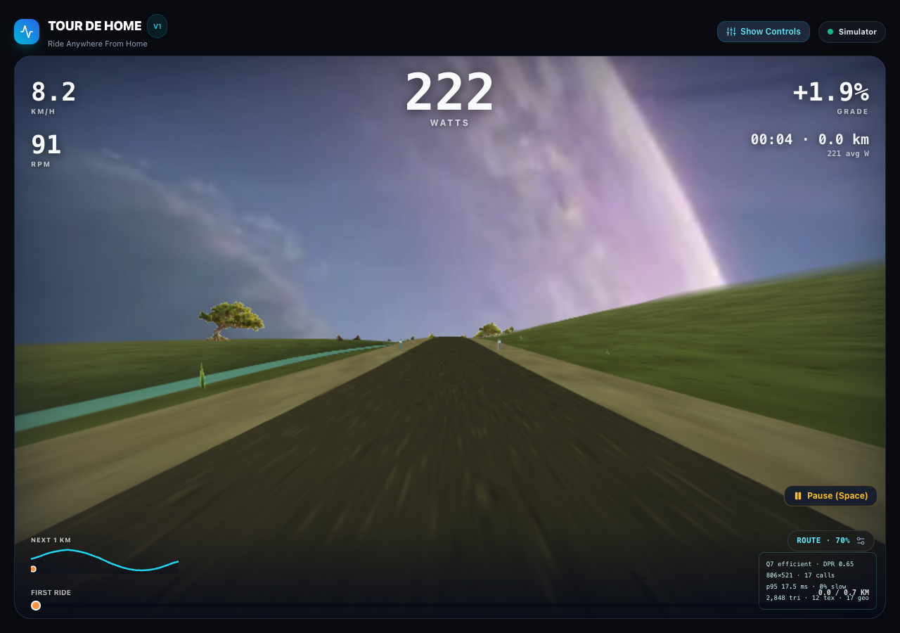

# Tour de Home

**Ride anywhere from home.** An open-source indoor cycling and treadmill app. Connect Bluetooth FTMS equipment, import a GPX course or an original Strava FIT activity, race your previous performance, explore scenic environments, and export FIT or TCX.

No account, subscription, API key, or private course archive is needed. Try the complete demo without a trainer.



*Actual app screenshot using the simulator and Efficient graphics; no physical trainer is connected.*

## Quick start

Install **Node.js 24.15.0** (the version in `.node-version`) and npm. Clone this repository, then install and start the app:

```sh
git clone https://github.com/vro3/tour-de-home-public.git
cd tour-de-home-public
npm ci
npm run dev
```

Open the localhost address printed by Vite. Choose **First Ride** in the Course Library, then **Demo Selected Route**. Pause, finish, and download FIT or TCX from the summary. The three included GPX courses and four built-in presets are original simulations, not real-world navigation routes. Import your own `.gpx` to ride a real course.

## Race Yourself

Save a ride, return home, and choose the same course. Under **Race Yourself**, select one previous attempt, then start your trainer ride or demo as usual. Choose **Ride without a ghost** to turn the comparison off.

A violet ghost follows your recorded progress in Scenic mode and appears as a marker in Map mode. The comparison bar keeps it visible when it is behind you or far away. The live gap compares your active riding time at the same course distance: **ahead** means you reached that point sooner. The finish summary includes the comparison.

Pauses and trainer reconnection time freeze both clocks. Recovery restores the selected opponent and the last committed active-time checkpoint. New recordings include precise active-time points; older rides without them remain saved/exportable but are excluded rather than guessing their pauses. Course geometry must match, even when two routes share a name. Partial previous rides are labeled and comparisons stop beyond their recorded distance. Ghost movement is interpolated between recorded points; it replays the recorded performance rather than recalculating it from today's rider settings.

## Ride with a trainer

Use a browser with Web Bluetooth in a secure context: desktop Chrome on macOS is the primary development target. HTTPS and localhost are supported origins. Browser capability is checked before pairing; browsers without it can still use the demo. See [Chrome's Web Bluetooth documentation](https://developer.chrome.com/docs/capabilities/bluetooth).

1. Power on an FTMS trainer. Close other apps that may hold its Bluetooth connection.
2. Set your rider weight and choose a route.
3. Click **Connect Trainer**, then **Connect FTMS Trainer**, and select your device in the browser chooser.
4. Check the connection badge, then start the ride.

**Route** mode sends the current gradient; difficulty scales resistance without changing route distance or virtual speed. **ERG** mode requests a watt target. The badge distinguishes resistance control from telemetry-only connections. Telemetry-only rides can record data but cannot control resistance.

Press **Space** to pause/resume; press **Escape** or click **Home** to open the exit choices. Pause and finish attempt to neutralize resistance. A broken Bluetooth connection cannot deliver a command: stop pedaling if the trainer feels wrong or a control error appears. Reconnection leaves the ride paused until you resume.

Physical KICKR CORE pairing, resistance, ERG accuracy, and recovery still need the [hardware acceptance test](docs/HARDWARE-TEST.md). Automated mocks do not establish device compatibility. The app is an experimental release, not a certified training device.

## Your routes and ride data

GPX import supports tracks, routes, namespaces, and multiple segments, with elevation smoothing. Files are limited to 20 MB and 200,000 points; malformed XML and custom XML entities are rejected.

Settings, selected routes, completed rides, and active-ride recovery stay in your browser's local storage and IndexedDB. There is no account or cloud sync. Export rides before clearing browser data or moving to another site address. Recovery preserves samples committed before interruption; the newest uncommitted sample may be lost.

Scenic mode uses bundled assets. Map mode requests map tiles from OpenFreeMap and elevation tiles hosted on AWS, revealing your IP address and the viewed map area to those services. Ride records are not uploaded by the app. FIT/TCX files can contain route coordinates and health-related readings; review them before sharing.

Development ride logging is **off by default**. To opt into a local `.telemetry.log` containing ride measurements, start with `VITE_RIDE_TELEMETRY=1 npm run dev`. It is never enabled in the production bundle. No external fonts or analytics are loaded.

## Scenic mode

Choose Daybreak, Moonride, Verdant Tide, Glacier Vault, Frozen Night, Cobalt Expanse, Alpine Fjord, Copper Ravine, Violet Metropolis, or Sunset Promenade. **Auto** adjusts rendering after sustained slow frames; **High** favors detail; **Efficient** reduces resolution and effects. Add `?scenicPerf=1` to show measured frame and scene counters. Terrain follows the imported GPX, while surrounding scenery is fictional.

## Development and verification

```sh
npm test                       # Unit/component/integration checks, including independent FIT decoding
npm run build                  # TypeScript and production bundle
npm run release:check          # Public file boundary and asset hashes
npm audit --omit=dev            # Runtime dependency advisories
npm run test:browser            # Actual browser crash, recovery, resume, and finish
npm run build -- --base=/tour-de-home/
npm run test:release-browser    # Subpath assets, narrow screens, demo, and UI exports
```

Browser checks use a fresh temporary Chrome profile and the mock trainer, block external browser requests, and save reports/screenshots in `artifacts/browser/`. On Linux set `CHROME_PATH=google-chrome`; on another setup set it to your Chrome executable. They do not touch your normal browser profile or trainer.

See [contributing](CONTRIBUTING.md), [architecture](docs/ARCHITECTURE.md), [security](SECURITY.md), and [release evidence](docs/RELEASE-CHECKS.md). Build tooling advisories and hardware limitations are disclosed there.

## Hosting and sharing

The app builds to `dist/` and runs on static HTTPS hosting. [Deployment instructions](docs/DEPLOYMENT.md) cover root domains and GitHub Pages subfolders. No deployment occurs automatically.

For a reviewed source snapshot, run `npm run release:prepare -- /absolute/path/to/a/new-directory`. This copies only the public release files, with checksums, and excludes Git history, private archives, owner-specific hosting settings, and old planning material. It refuses to overwrite an existing directory.

## License and credits

Original code and included original assets are [MIT licensed](LICENSE). See the [asset inventory and provenance](docs/ASSETS.md) and [third-party notices](public/THIRD-PARTY-NOTICES.txt). External maps and dependencies retain their own licenses. This project is independent and is not affiliated with trainer manufacturers, race organizers, map providers, or fitness platforms.

## Import an original Strava FIT activity

On your Strava activity page, choose **Export Original**. If it downloads a ZIP, extract it first. In Tour de Home, choose the `.fit` file under **Import a Strava ride or run**. The course and its ghost are selected together. Imported activities stay in this browser and can be selected again from **Saved imported activities**. Re-importing the same file does not create duplicate history. No Strava account connection or server upload is involved.

The importer checks FIT integrity and uses recorded timer start/stop events to remove pauses. Stationary time with the recording timer running still counts. It checks those events against the activity's timer total; files with missing or contradictory pause information are rejected with an explanation rather than guessed. Continuous recordings without events are accepted only when timer and elapsed duration agree within FIT's one-second timestamp resolution. Sparse device recordings are interpolated between their recorded distances using active seconds only; pauses are never spread over the ride. Multisport files, distance that changes while the timer is paused, nonmonotonic distance, and damaged files are not supported in this version. Limits: 20 MB, 200,000 records, 2,000 km. The comparison reflects the original device's recorded timer, not Strava's separately calculated moving time.

Cycling, running, and walking files with a distance stream are supported. Recorded GPS becomes the course; activities without a complete GPS stream use a labelled flat virtual course of the recorded distance. That virtual geometry is never exported as GPS and Map view is disabled for it. FIT exports from new recordings include pause events at FIT's one-second resolution. Older recordings without per-sample active time cannot supply those events reliably.

## Treadmill sync

Choose **Connect Trainer → Connect FTMS Treadmill** in a Web Bluetooth browser on HTTPS or localhost. The treadmill must broadcast the standard **FTMS Treadmill Data** characteristic (0x2ACD). Then select a course or imported run, choose **LOAD COURSE**, and start moving using the treadmill console. Live belt speed drives course distance directly, without cycling power physics. The display shows speed, pace, time, distance, and incline/heart rate when supplied.

This is a read-only connection. **Pause, Finish, loss of Bluetooth, and closing the app do not stop the treadmill belt. Use the treadmill console and safety key.** The app does not request a control point or write speed, incline, start, or stop commands. Course slope does not change the treadmill incline. The app pauses its comparison on a zero speed reading, lost connection, or speed data older than 2.5 seconds. After a stop or reconnect, wait for a fresh speed reading and press **Resume** explicitly. Recovery retains the running activity type and requires treadmill pairing to continue; switching to cycling equipment requires finishing the activity first.

Saved treadmill sessions export as **running / treadmill** in FIT and **Running** in TCX. Software tests exercise a simulated FTMS device; physical treadmill compatibility must still be checked with your model. Proprietary Bluetooth protocols and automatic Strava synchronization are not implemented.

## Project origin

See [project origin and provenance](ORIGIN.md) for maintainer attribution, the first public release, and a privacy-preserving commitment to the retained development record.
